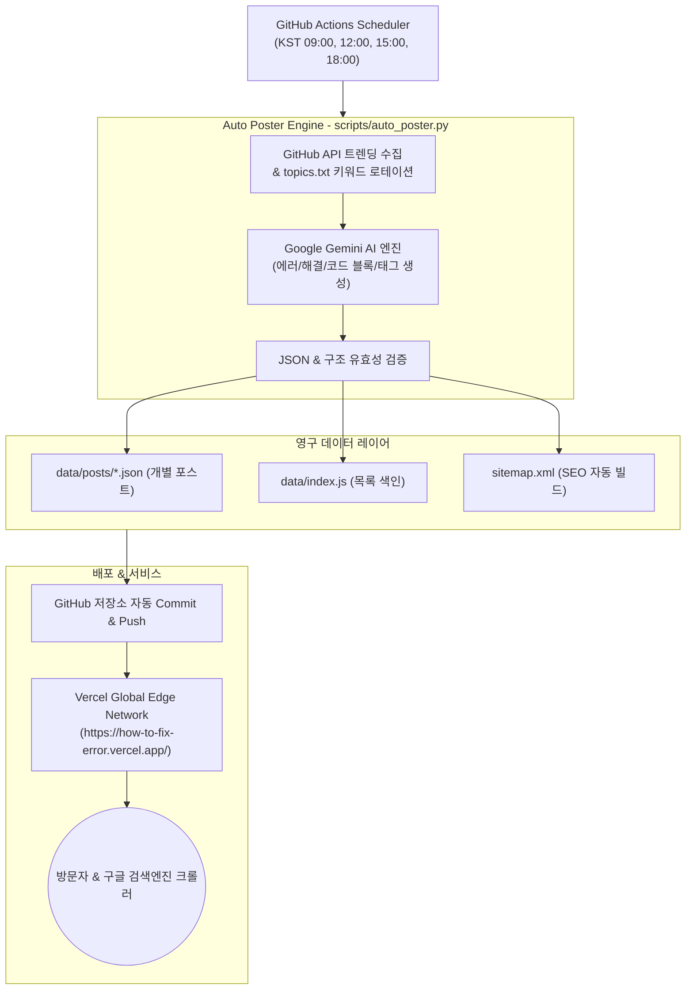

<div align="center">

# ⚡ ErrorLog
### AI 기반 프로그래밍 에러 해결법 & 개발 트렌드 자동 포스팅 허브

[](https://github.com/HenryParkG/how-to-fix-error/actions/workflows/daily-post.yml)
[](https://how-to-fix-error.vercel.app/)
[](https://ai.google.dev/)
[](https://how-to-fix-error.vercel.app/)
[](https://opensource.org/licenses/MIT)

<p align="center">
  <b>현업 개발자가 마주치는 실제 에러 로그와 최신 GitHub 트렌딩 오픈소스 가이드를 AI가 매일 자동 분석하여 발행합니다.</b><br>
  원인 분석, 에러 재현 코드, 검증된 해결 코드 및 실무 팁을 네온 다크모드 글래스모피즘 인터페이스로 제공합니다.
</p>

[🌐 라이브 웹사이트 방문](https://how-to-fix-error.vercel.app/) • [✨ 핵심 기능](#-핵심-기능) • [🏗️ 자동화 파이프라인](#️-자동화-파이프라인) • [🚀 로컬 실행 & 기여](#-로컬-실행-방법)

</div>

---

## 📌 개요 (Overview)

개발 중 마주치는 수많은 오류 코드(`TypeError`, `NullPointerException`, `CORS`, `Out of Memory` 등)와 급변하는 오픈소스 기술 생태계를 한곳에서 빠르고 직관적으로 검색할 수 있는 자동화 개발 지식 저장소입니다.

* **GitHub Trending 실시간 연동**: 주간 가장 인기 있는 신규 GitHub 오픈소스 트렌드를 자동 수집하여 왜 주목받는지와 실무 사용법을 브리핑합니다.
* **실전 문제 해결 중심 포맷**: 단순 이론이 아니라 `[발생 원인] ➡️ [오류 코드] ➡️ [수정 코드] ➡️ [핵심 체크리스트]` 구조로 개발자가 즉시 복사하여 적용할 수 있습니다.
* **검색 엔진 & 수익화 최적화**: 매 포스팅 배치 시마다 `sitemap.xml`이 자동 갱신되며, Google AdSense 광고 영역이 최적화되어 있습니다.

---

## ✨ 핵심 기능 (Key Features)

| 기능 | 세부 내용 |
| :--- | :--- |
| **🔥 GitHub Trending 연동** | GitHub Search API를 통해 최근 7일간 가장 급상승한 인기 저장소를 추출하여 심층 튜토리얼 자동 작성 |
| **🤖 Gemini AI 다중 모델 폴백** | API 부하 및 할당량 제한을 방지하기 위해 `gemini-flash-latest`부터 `3.1-pro`, `2.5-flash`, `2.0`, `1.5` 순으로 자동 전환(Failover) |
| **💻 코드 대비 뷰 (Before & After)** | 버그를 일으키는 Snippet 코드와 정답 Fix 코드를 명확히 분리하여 구문 강조(Syntax Highlighting) 제공 |
| **🔍 실시간 검색 & 태그 필터** | Python, JavaScript, TypeScript, Docker, Kubernetes, React, C++ 등 언어/환경별 원클릭 필터링 |
| **🗺️ 완전 자동 SEO 색인** | 글이 생성될 때마다 `sitemap.xml`에 새로운 URL이 자동 추가되어 구글 서치 콘솔에 즉각 반영 |
| **⚡ 일 12편 자동 발행 파이프라인** | 하루 4회(09, 12, 15, 18시 KST) 정기 배치로 매회 3편씩 고품질 기술 아티클 자동 생산 |

---

## 🏗️ 자동화 파이프라인 (Workflow Architecture)



---

## 📂 프로젝트 구조 (Project Structure)

```bash
how-to-fix-error/
├── .github/
│   └── workflows/
│       └── daily-post.yml      # 하루 4회(총 12편) 자동 포스팅 및 Git 커밋 워크플로우
├── assets/
│   ├── css/                    # 사이버펑크 네온 다크모드 및 반응형 CSS
│   └── js/                     # 클라이언트 검색, 필터, 렌더링 스크립트
├── data/
│   ├── index.js                # 전체 아티클 메타데이터 리스트
│   └── posts/                  # 개별 포스트 상세 JSON 파일 저장소
├── pages/
│   ├── solutions.html          # 에러 해결 모음 페이지
│   ├── trends.html             # GitHub 트렌딩 분석 모음 페이지
│   ├── post.html               # 개별 포스트 상세 읽기 뷰
│   ├── about.html              # 서비스 소개 페이지
│   ├── privacy.html            # 개인정보처리방침
│   └── terms.html              # 이용약관
├── scripts/
│   ├── auto_poster.py          # GitHub 트렌딩 추출 및 Gemini AI 글 작성 코어 엔진
│   └── topics.txt              # 예비 에러 키워드 및 토픽 풀
├── ads.txt                     # Google AdSense 공식 인증 파일
├── index.html                  # 메인 페이지 포털
├── sitemap.xml                 # 검색엔진 최적화(SEO) 사이트맵
└── vercel.json                 # Vercel URL 라우팅 및 리라이트(Rewrite) 설정
```

---

## 🚀 로컬 실행 방법 (Local Quickstart)

### 1. 프로젝트 복제
```bash
git clone https://github.com/HenryParkG/how-to-fix-error.git
cd how-to-fix-error
```

### 2. 가상환경 세팅 및 패키지 설치
```bash
python -m venv .venv
# Windows
.\.venv\Scripts\activate
# Mac / Linux
source .venv/bin/activate

pip install google-generativeai python-dotenv
```

### 3. 환경 변수 (`.env`) 설정
로컬 루트 디렉터리에 `.env` 파일을 만들고 Google AI Studio 키를 입력합니다 (Git 추적 제외됨):
```env
GEMINI_API_KEY=your_gemini_api_key_here
```

### 4. 수동 포스팅 테스트
```bash
# 기본 1개 포스트 생성
python scripts/auto_poster.py

# 한 번에 3개 배치 생성
python scripts/auto_poster.py --count 3
```

---

## ⚙️ CI/CD 자동화 환경 설정

이 저장소는 GitHub Actions와 Vercel을 연동하여 100% 무인으로 관리됩니다:

1. **GitHub Secrets 설정**:
   * 저장소의 `Settings` ➡️ `Secrets and variables` ➡️ `Actions`에 `GEMINI_API_KEY`를 추가합니다.
2. **Vercel 배포**:
   * [Vercel](https://vercel.com/) 대시보드에서 `how-to-fix-error` 레포지토리를 불러와 배포하면, GitHub Actions가 커밋을 푸시할 때마다 Vercel이 수 초 내로 자동 실시간 배포합니다.

---

## 🛠️ 기술 스택 (Tech Stack)

| 영역 | 기술 스택 |
| :--- | :--- |
| **Language & Runtime** | Python 3.10+, Modern JavaScript (ES6+) |
| **Generative AI** | Google Gemini API (`google-generativeai`) |
| **Crawler & APIs** | GitHub REST Search API, urllib |
| **Hosting & CI/CD** | Vercel Edge Network, GitHub Actions |
| **Styling & UI** | Glassmorphism, CSS Custom Properties, FontAwesome, Highlight.js |
| **Monetization & SEO** | Google AdSense, Dynamic XML Sitemap Generator |

---

<div align="center">
  <sub>Crafted for developers worldwide by <b>Hyunsung Park (@HenryParkG)</b></sub>
</div>
